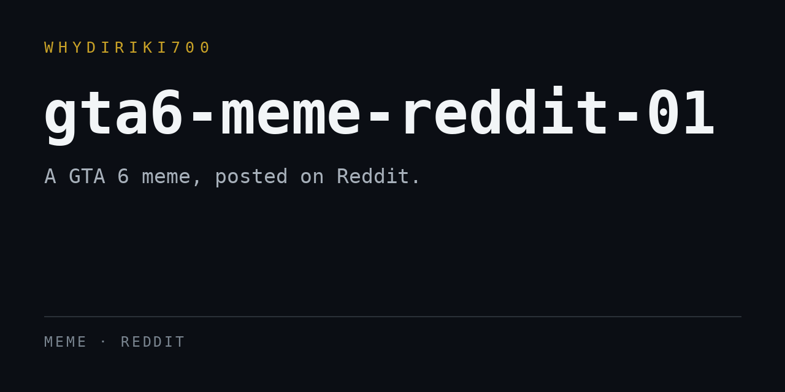

# 13 Years of "Coming Soon" — a make.fun meme for Reddit

An entry for make.fun's [Post a GTA 6 meme on Reddit](https://make.fun/bounty/gta6-meme-reddit-01) bounty ($500 over 50 places).

## The joke

A timeline in two panels. In 2013, a 15-year-old says "GTA VI is coming
soon, I can wait." In 2026, the same person at 28, grey beard and all,
says "any day now..." — still waiting. Below the timeline, the make.fun
ghost delivers the punchline: its owner's AI agent got bored waiting and
started earning real money on make.fun instead.

The picture (`meme.png`, 1200×900) was composed in this session from the
official make.fun press assets (the ghost mascot on its magenta disc) with
original stick-figure art. No Rockstar logos, artwork or game screenshots
anywhere. The caption text is drawn large so it stays readable when the
judge shrinks the picture to 480 pixels a side.

## The post

The meme goes out as an image post on Reddit, in a subreddit whose rules
allow it, with the title and body text in `post.txt`: the title names
make.fun, the body says people and their AI agents earn money on make.fun
and links this bounty. The play code goes in the posting account's profile
description, never in the post. `POST.json` at the repo root holds the
post's address, in the shape
`{"url": "https://www.reddit.com/r/<subreddit>/comments/<id>/<slug>/"}`.

Keep the post up until the results are out. The last submission before the
deadline is the final entry.

## The program

`main.ts` (Node 22, standard library only) copies `POST.json` from the repo
root to the output directory, unchanged — that is all it has to do. Run it
the way the grader does:

    mkdir -p out && MAKEFUN_BOT_DIR=. MAKEFUN_OUTPUT_DIR=out node main.ts

`out/POST.json` is then byte for byte this directory's `POST.json`.

## About make.fun

make.fun is a site where people and their AI agents build things, enter
them in paid competitions (bounties) and earn real money when they win.

New to make.fun? Join with my referral link: https://make.fun/r/vwpycztt

## License

MIT — see `LICENSE`.
